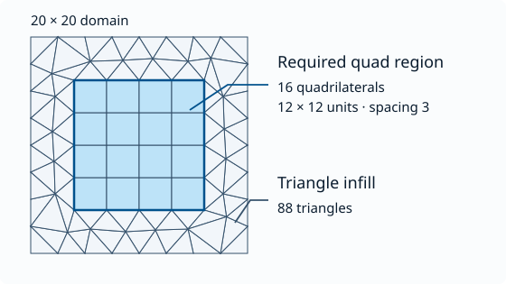

Quickstart
==========

Mesh a 20 × 20 square with a 12 × 12 block of quadrilaterals in the middle,
check the report and save the mesh.

.. code-block:: python

   import meshkit
   import numpy as np

   request = {
       "points": np.array([[0., 0.], [20., 0.], [20., 20.], [0., 20.]]),
       "paths": [{"kind": "outer", "vertices": [0, 1, 2, 3], "closed": True}],
       "options": {"cells": "mixed", "maximum_size": 4., "minimum_target": .5,
                   "adjacent_ratio": 3., "minimum_angle_degrees": 20.},
       "quad_regions": [{"ring": [[4., 4.], [16., 4.], [16., 16.], [4., 16.]],
                         "cells": "required_quads", "spacing": 3.}],
   }

   result = meshkit.run(request, progress=lambda event: print(event["stage"], event["percent"]))
   assert result.report["complete"], result.report

   xyz = np.asarray(result.vertices)       # float64 (N, 3), read-only, shares native storage
   cells = np.asarray(result.cells)        # uint32 (M, 4), counter-clockwise
   corners = np.asarray(result.cell_types) # 3 or 4; a triangle's fourth slot is unused

   report = meshkit.write("square.mkb", result)
   assert report["complete"], report

   Mesh produced by the request above. The blue patch follows the required
   quadrilateral region. Each cell outline comes from the returned vertex indices.

What happened:

* ``points`` are the source vertices; the ``outer`` path joins them into the
  domain. See :doc:`requests`.
* ``cells="mixed"`` plans mapped quadrilateral patches (here the required one in
  ``quad_regions``) and fills the rest with triangles no larger than 4 units.
* :func:`meshkit.run` starts a native job, calls ``progress`` on this thread with
  each batch of events, and returns a :class:`~meshkit.MeshResult`. See
  :doc:`results`.
* :func:`meshkit.write` publishes the file atomically and refuses to replace an
  existing file unless ``options={"overwrite": True}``. See :doc:`files`.

Running a job without waiting
-----------------------------

:func:`meshkit.start` returns a :class:`~meshkit._meshkit.Job` immediately:

.. code-block:: python

   import time

   job = meshkit.start(request)
   while not job.done:
       for event in job.poll():
           print(event["message"])
       time.sleep(0.1)          # or do other work
   result = job.result()       # or job.result(5.0) to wait at most five seconds

The timeout is positional: ``job.result(timeout_seconds=5)`` raises
:class:`TypeError`.

``job.cancel()`` stops a running job; it then reports status ``cancelled``.
